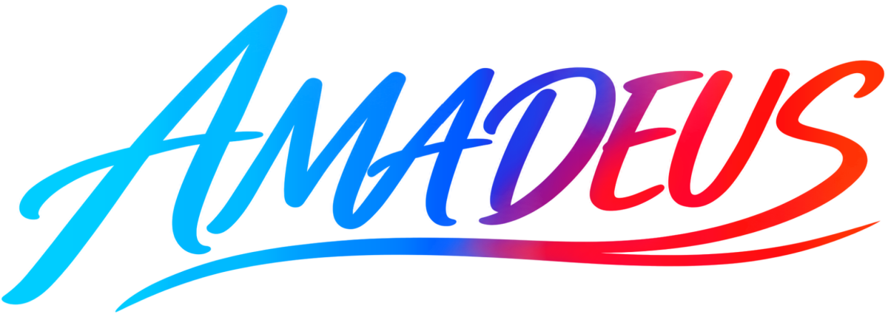

  

  
  
  

 

  <a href="https://amadeus.jpmyrmecol.com/">English</a> |
  <a href="https://amadeus.jpmyrmecol.com/jp/">日本語</a>

---

**Annotation-free Multi-Animal Direction Estimation Using Self-supervised learning**

AMADEUS is a markerless multi-animal tracking system for laboratory videos. It estimates an oriented bounding box (OBB) and head direction for each animal while maintaining individual identities over time. No manual training annotation or physical marking is required.

## Install and launch

Download and run the [installer for your operating system](https://amadeus.jpmyrmecol.com/#install). Initial setup requires an internet connection. The installer prepares the required software; follow any prompts that appear. On macOS, new installations use `~/Applications/AMADEUS`, while existing AMADEUS installations are reused at their current locations.

AMADEUS supports NVIDIA GPUs on Windows and Linux, Apple Silicon on macOS, and some AMD GPUs via ROCm. For NVIDIA and AMD GPUs, 8 GB or more of VRAM is recommended; memory requirements depend on the video and animal count. Operation has also been confirmed on an NVIDIA laptop GPU with 4 GB of VRAM.

You can also install using Git or a ZIP download. See the [Git and ZIP instructions](https://amadeus.jpmyrmecol.com/Manual_EN.html#section-1). A Git clone creates a new `AMADEUS` folder in the current directory and cannot overwrite an existing folder. For an existing installation, use the downloadable OS installer or the in-app Update button. For ZIP installation, choose **Code → Download ZIP** on [GitHub](https://github.com/jpmyrmecol/AMADEUS) and extract the archive.

| Operating system | Launcher |
| --- | --- |
| Windows 10 / 11 | Double-click `AMADEUS.bat` |
| macOS on Apple Silicon | Open `AMADEUS.command` |
| Linux / WSL2 | Run `bash AMADEUS.sh` |

After setup, use the desktop shortcut on Windows or run `amadeus` in a terminal. For platform-specific instructions and troubleshooting, see the [manual](https://amadeus.jpmyrmecol.com/Manual_EN.html#section-1).

To update, select **Update** on the Home screen.

## Run tracking

1. Open **Easy Tracking** and select the video.
2. Select **Launch Segmentation**. Configure foreground segmentation so that complete, isolated animals are retained as single-animal blobs and unsuitable regions are marked as outliers.
3. Specify the number of animals, overlap severity, and whether the animals move backward. Select **Processing** to run the workflow.
4. Review the result video and CSV. Use **Refinement** to correct remaining errors if needed.

Use **Advanced Tracking** to configure individual stages and parameters, or **Multi Config Batch** to run several saved configurations.

Home panels also accept drag-and-drop inputs: drop an AMADEUS tracking `config.yaml` on **Easy Tracking**, **Advanced Tracking**, **Refinement**, **Multi Config Batch**, or **Colab**; drop `segmentation_gui_config.json` on **Segmentation**; or drop a `*_cropping_trimming_config.yaml` file on **Cropping & Trimming**. **Multi Config Batch** accepts several YAML files at once and adds them to the queue without running them. Video drops remain supported on the original video-enabled panels.

## Add-ons

Select **Add-ons** above **Update** on Home to install an independent application from a ZIP using drag and drop or **Browse**. Installed add-ons appear on the right with their version, declared OS support, and **Update** / **Uninstall** menus. Drag the panels to reorder them; order is saved. Developers can optionally enable Home file/video drops using `drop_extensions` in `addon.json`. Their environments and settings remain separate from AMADEUS's Python environment and are retained across AMADEUS updates. On Linux, they reside under the same AMADEUS data directory as a standard installation. Uninstalling an individual add-on deletes its complete folder, including settings, data and logs; updating an add-on preserves these files. Uninstalling AMADEUS also removes all installed add-ons, including their saved settings, data and logs.

Only install add-ons from developers you trust. They are not sandboxed. See the [add-on guide](tools/ADDONS.md) and [official template](https://github.com/jpmyrmecol/AMADEUS-Addon-Template) for the file interface, package format, licensing boundary and developer instructions.

## Outputs and recording conditions

The standard output includes individual identity, OBB center and dimensions, and head direction in degrees over time. Front and rear keypoints are derived from OBB geometry; they are not directly detected anatomical landmarks. In the final CSV, columns named `heading` store head direction. See the [output format](https://amadeus.jpmyrmecol.com/Manual_EN.html#section-12) for coordinates, angles, and processing stages.

AMADEUS learns directly from the input videos. Recommended conditions include a fixed camera viewing animals from above, movement approximately confined to a two-dimensional plane, stable illumination, an essentially static background, and sufficient contrast, resolution, and frame rate for reliable visual tracking in each frame. Head direction estimation requires a body axis and visually distinguishable front and rear. The video must contain sufficient periods in which animals are separated from one another to generate training data. Training and analysis videos can be recorded separately under the same conditions.

**Without direction estimation** tracks OBBs and identities without assigning front or rear. **Variable population** supports animals entering or leaving the frame, but re-entering animals may receive new IDs. Both modes are beta features and are off by default. Check their results carefully; see the [manual](https://amadeus.jpmyrmecol.com/Manual_EN.html#section-6) for details and limitations.

## Citation

Preprint: Yusuke Notomi, Kentarou Matsumura, and Shigeto Dobata (2026). **AMADEUS: Annotation-free multi-animal direction estimation using self-supervised learning.** bioRxiv. https://doi.org/10.64898/2026.09.19.752854

See the [Publication page](https://amadeus.jpmyrmecol.com/publication.html) for citation information. Please also cite the project website: https://amadeus.jpmyrmecol.com/.

## License

AMADEUS is distributed under the GNU Affero General Public License v3.0 only (AGPL-3.0-only). See [LICENSE](LICENSE) and [third-party notices](THIRD_PARTY_NOTICES.md).

